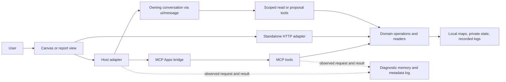

# Plugin review — current status and improvement plan

Follow-up: [accepted ownership contract and implementation](../design/repo-workbench/2026-10-23-architecture/README.md). This audit preserves the original baseline; source links now point to current owners where files moved.

Reviewed 23 October 2026, Asia/Shanghai. Scope: Repo Workbench, especially its MCP
Apps; Example MCP App as the companion integration reference. This is a review
and proposal, not an implementation or release approval.

**Assessment:** the product architecture is sound and the automated coverage is
substantial. The next useful work is to make lifecycle, ownership, inspection and
delivery rules consistent. A rewrite or a general plugin framework is not justified.
The clearest user-visible defect is diagnostic retention: a Canvas send became
uninspectable after about 64 seconds while the panel remained open.

[Annotated interface review](../design/repo-workbench/2026-10-23-mcp-review/index.html)
· [MCP contracts and conversation routes](../design/repo-workbench/2026-10-23-mcp-review/integration.html)
· [Evidence and coverage](../design/repo-workbench/2026-10-23-mcp-review/README.md)

## Current status

The baseline is working-tree content over `9549a5af33de`, including 43 modified
tracked files and seven untracked entries already present when review began.
The latter include the new diagnostics modules. A frozen copy of 244 source files
was built and tested with Node 24.21.0 and npm 11.19.0. Source hashes are retained
with the review. No existing implementation files were changed by this review.

| Layer | Verified state | Limit |
| --- | --- | --- |
| Committed source | Workbench 0.4.3; Example 0.3.0 | These are not the versions currently installed. |
| Reviewed working source | Workbench 0.5.0 / `1dc28cdaa0f3`; Example 0.4.0 / `ee6534427155` | Includes unfinished, uncommitted work. |
| User installation and Codex cache | Same version numbers; current workspace HTML matches both installed copies byte for byte | A matching manifest is not a clean source release. |
| Fresh bundled servers | Discovery, tools, resources and failure probes exercised | Fixture repositories and logs, not private production sessions. |
| Attached servers in this chat | Canvas reports 0.5.0 / `1dc28cdaa0f3`; Example reports `ee6534427155` | This verifies the server, not the rendered panel or conversation delivery. |
| Rendered UI | Actual bundled UI exercised in an SDK fixture host; screenshots and interaction evidence captured | Host acknowledgments were simulated locally. No real message was sent. |

The frozen build's Canvas HTML exactly matches the installed file. Reports and
Example HTML differ only in bundler `//#region` path comments caused by using the
existing dependency directory from the temporary copy. Removing those comments
produces identical content. This is recorded explicitly rather than treating
source fingerprints as byte hashes.

**Checks:** Workbench's full check passed: 44 Vitest tests plus 49 Node tests;
two Node tests were skipped initially. The sandbox-skipped usage loopback test
then passed in an approved standalone run. The optional native configuration
probe was not run. Workbench browser tests passed **44/44**. Example checks passed
**12/12** and browser tests **11/11**. Root tests passed **103/106**, with three
optional Copier tests skipped; source skill verification passed. Dependencies
were reused, so this is not a fresh empty-cache dependency-install proof.

## Why the plugin exists

The product gives the user and the assistant a shared view of local evidence:

- **Canvas:** discuss a repository model, inspect its sources, compare a proposed
  change, apply it to a draft, then save deliberately.
- **Usage:** understand recorded token usage and drill into the accounting records
  behind a total. It describes telemetry; it does not claim billing accuracy.
- **Trace review:** move from a session or selected turn to recorded messages,
  actions, outputs and provenance without loading every body at once.
- **Example:** teach and inspect the App → Host → Server and App → Conversation
  routes, including missing capabilities, errors and uncertain delivery.

Embedding is valuable because the discussion stays with the visual selection.
Standalone modes preserve local usefulness and offline review. The plugins do
not own an LLM or run a second assistant. This matches the official MCP Apps
model: a tool advertises an HTML resource, the host renders it in a sandbox, and
the app uses the host bridge for tools and messages.
[Official MCP Apps overview](https://modelcontextprotocol.io/extensions/apps/overview).

The current form reflects incremental extraction and hardening: Workbench came
from Card Workshop; Canvas acquired typed operations and draft/proposal owners;
usage and trace later reused the existing renderers; diagnostics are now being
added across the applications. That history explains the remaining unevenness.
It does not imply that each renderer must now be rewritten in the same framework.

## What is shipped

| Package / server | Surface and entrypoint | Domain and persistence owner |
| --- | --- | --- |
| Workbench / `repo_canvas` | Canvas: `canvas_open`, then `canvas_app` | `repo-canvas/src/model`, `Repository`, `CanvasBridge`, `DiscussionStore` |
| Workbench / `workbench_reports` | Usage: `usage_open`; trace: `trace_open`; app calls through `report_app` | Usage scan/index/overview; trace reader; report contexts and frozen selections |
| Example / `example_mcp_app` | `example_open`, real demo tools/resources, explicit fixture mode | Trace recorder → observation store → sequence projection; bounded panel reports |

Fresh `tools/list` probes found **19 Canvas**, **14 report**, and **10 Example**
tools, including app-only diagnostics. Canvas and reports each expose one HTML
resource; Example exposes its HTML and a demo resource, plus a parameterized
resource template. None of these 43 tool registrations currently declares an
`outputSchema`. This is not a protocol violation: Canvas validates internal
operation outputs and reports decode their own envelopes. It does mean the
generated catalog describes inputs much better than results.

The prebuilt npm packages contain the runtime and UI assets. Workbench has two
stdio entrypoints and the standalone CLI; Example has its own stdio server and
fixture preview. Runtime dependency installation is unnecessary. Plugin/catalog
setup is separate from domain state and preserves unrelated configuration.

## How the main routes work

**Canvas connection:** the server resolves a canonical repository and creates an
opaque context. A Codex-specific adapter can resolve a trusted chat ID through
the local state database; explicit repository selection remains the fallback.
`HostClient` owns SDK calls; `host.ts` owns connection/recovery; the draft reducer
owns document history and navigation. A confirmed missing context can reconnect;
an uncertain transport failure does not automatically replay a mutation.

**Canvas change:** a proposal carries its basis. Shared proposal review compares
it with the current draft and checks consent where needed. Apply changes the
draft; Save writes the map with revision checking. Source-block edits use a
separate diff and file revision, validate Git-visible paths, reject symlinks and
preserve file permissions. These are strong seams worth preserving.

**Discussion:** ordinary text goes directly through `ui/message`. When the user
chooses to attach context, the app captures the selected scope and sends a bounded
summary with handles for later reads. Full maps, text and provenance have separate
scoped tools. Host acceptance remains distinct from arrival and an assistant reply.

**Reports:** opening usage starts a scan worker and can show a cached summary.
The app adopts refreshed data under a new revision. Existing standalone renderers
mount inside the embedded shell. Exact records, long text and images load on
demand through `report_app`; compressed payloads live in `_meta`. Source hashes
pin subsequent reads. Frozen discussion selections survive refresh until eviction.

**Diagnostics:** Workbench's `ObservableServer` records SDK envelopes and derives
the tool catalog from registrations. `AppDiagnostics` records app calls and owns
the inspector. Payloads remain in bounded memory; disk logs contain metadata;
one selected payload capture requires an explicit action. These are observations
of visible seams, not host/model internals.

## Findings, in priority order

### 1. Background polling evicts the user interaction being investigated

**Confirmed, P2.** A synthetic plain Canvas send was inspected successfully, then
became an empty “Inspect last send” view after 63.7 seconds. No panel closure or
server restart occurred. The inspector gave no explicit expiry explanation.

The app retains 250 events and the server store 500. Canvas polls the agent inbox
every 750 ms, document state every three seconds, discussion every two seconds
when mounted, and republishes an unchanged view about every five seconds. These
calls produce request/result records and additional `diagnostics_append` calls.
The default list labels them all `tools/call`; the selected payload sits after the
entire list. The inspected fixture recorded 1,392 tool-call observations versus
two message observations in roughly five minutes.

**Improve:** distinguish user interactions from housekeeping at record creation.
Use separate bounded budgets; retain complete request/result groups, and pin the
currently inspected interaction in memory. Show expiry and dropped counts at the
point of inspection. Give rows operation names such as `save` or `source`, and
put the payload beside the selected row in a stable split view. Keep automatic
disk logging metadata-only. A larger undifferentiated ring would only delay the
same problem.

**Acceptance:** after 90 seconds of realistic polling, a recent send still has
its frozen request, result and explicit capture route; housekeeping remains
bounded; deliberate expiry produces a clear unavailable state; no action replays.

Evidence: [retention observation](../design/repo-workbench/2026-10-23-mcp-review/evidence/retention-observation.json).
Owners: [Recorder](../../plugins/mcp-app-runtime/src/events.ts),
[inspector](../../plugins/repo-workbench/packages/diagnostics/client.ts),
[agent polling](../../plugins/repo-workbench/packages/repo-canvas/src/ui/useCanvasAgent.ts),
[document polling](../../plugins/repo-workbench/packages/repo-canvas/src/ui/useCanvasDocument.ts),
[discussion polling](../../plugins/repo-workbench/packages/repo-canvas/src/ui/SideChat.tsx).

### 2. Chat ownership is enforced on one route but omitted on others

**Confirmed in a shared-server fixture, P2; installed exposure not established.**
A context opened with chat A rejects chat B through `canvas_app`, but the same
server allows B to discover that context, read its complete reported snapshot,
and enqueue a view command through the agent-facing tools. Those handlers never
resolve the caller's metadata. This matters if a host multiplexes chats onto one
server; the current review does not establish that Codex does so.

**Improve:** a small context registry should own lookup *and* caller policy.
Every context/request tool should resolve through it. Define the trusted
standalone case explicitly. Do not rely on opaque IDs or app-only visibility as
the ownership check. Apply the same reasoning to report selections and diagnostic
sessions before treating them as shareable across panels or chats.

**Acceptance:** a transport-level matrix covers owner, another chat, missing
metadata, fixed standalone context and restarted server for reads and mutations.
The cross-chat command must be rejected before enqueueing.

Evidence: [boundary probes](../design/repo-workbench/2026-10-23-mcp-review/evidence/boundary-probes.json).
Owner: [Canvas MCP handlers](../../plugins/repo-workbench/packages/repo-canvas/src/server/mcp.ts),
especially `canvas_app` versus `canvas_requests`, `canvas_snapshot`,
`canvas_command`, `canvas_propose` and request-based reads/replies.

### 3. An orphaned discussion lock has no restart recovery

**Confirmed with a synthetic orphan lock, P2.** `DiscussionStore` acquires a lock
by creating a directory and removes it in `finally`. A crash between those steps
leaves the directory behind. A new store instance still reports “Another panel is
updating”; reloading cannot repair it. The current lock has no owner or expiry.

**Improve:** use an owned lock with process/instance identity and a bounded stale
recovery rule, or a small transactional store if that also solves a demonstrated
need. Never delete a lock merely because it is old. Preserve revision comparison
inside the acquired lock and preserve the existing atomic file replacement.

**Acceptance:** kill a writer while holding the lock, restart, then recover without
losing the prior discussion. Two live writers must still conflict safely.

Owner: [DiscussionStore](../../plugins/repo-workbench/packages/repo-canvas/src/server/discussion.ts).

### 4. The report adapter's claimed document type is stronger than its validation

**Confirmed validator gap, P2.** `documentSchema` accepts a v3 document with a
thread whose `turns` is `[null]`. A thread of `null` makes `safeParse` throw a
`TypeError` from the custom predicate. This does not prove normal log parsing
emits malformed documents; it shows that the external boundary fails to provide
the contract its TypeScript type promises.

**Improve:** make the canonical ReviewDocument owner provide a structural parser
for nested threads, turns, events and body references, with bounded fields and
helpful errors. Reuse it at transport and persisted-document boundaries. Keep
semantic provenance checks in the source reader rather than duplicating them in
the UI. Derive request-to-result types so callers do not each reconstruct them.

**Acceptance:** malformed nested fixtures return a validation error and a
recoverable view, not a mount-time exception. Valid archived and lazy documents
continue to render without eager body loading.

Owners: [report contracts](../../plugins/repo-workbench/packages/reports/contracts.ts),
[canonical review types](../../plugins/repo-workbench/packages/session-review/src/model/contracts.ts).

### 5. Example has local behavioral coverage but no matching CI job

**Confirmed workflow gap, P2.** The Workbench workflow runs checks and browser
tests. The MCP-app-skill workflow tests the generated starter. The fresh npm job
installs both tracked packages, but it does not execute Example's behavior suite.
Root checks do not replace it. Thus a change confined to Example can miss its
protocol/browser regressions in hosted CI.

**Improve:** run the existing check and browser commands for each executable
plugin, with explicit paths or a short package matrix. Keep the starter job
separate because it verifies generated output. If shared source is introduced,
include its path in every affected workflow trigger.

Owners: [Workbench CI](../../.github/workflows/workbench.yml),
[starter CI](../../.github/workflows/mcp-app-skill.yml),
[install CI](../../.github/workflows/npm-install.yml),
[Example commands](../../plugins/example-mcp-app/package.json).

## Architecture and abstraction improvements

### A. One host-session module, with product-specific recovery

Canvas has `HostClient` plus a repository connection owner; reports mix SDK setup,
connection state, polling, rendering, compression and message sending in a
502-line entry module; Example owns a third lifecycle in its larger teaching
controller. This is a concrete policy duplication, not a reason to combine the
products.

A shared module should expose a small interface: connect, capability state,
typed tool call, send frozen message, external link/download, and dispose. It
should own aborts, initialization retries, response error classification and
host theme/context updates. Product adapters retain repository recovery, report
revision adoption and the Example's visible protocol scenarios.

Use explicit states such as connecting, ready, unavailable, incompatible and
closed. Distinguish rejected, timed out/uncertain, cancelled and failed operations
with structured error codes. Today recovery and UI messages sometimes depend on
error string prefixes, and the shared inspector labels every thrown error
“unconfirmed,” including failures known to precede delivery.

Do not make identical build hashes the only long-term compatibility definition.
Keep build identity for diagnostics/cache keys and add a small explicit protocol
version when coordinated compatibility becomes necessary. Until then, preserve
the existing conservative behavior and make mismatch handling consistent.

### B. Deepen report sessions before unifying renderers

Canvas already shares `operate()` across HTTP and MCP. Reports share readers and
renderers, but session orchestration lives separately in `reports/server.ts` and
the standalone server in `usage/build.ts`. Context revision, scan adoption, trace
retention, source reads and refresh errors are learned in multiple places.

Extract a `ReportSession` module that owns snapshot/status/refresh, trace lookup,
bounded evidence reads and frozen selections. HTTP and MCP become envelope and
authorization adapters. Compression should be outside the domain module. Reuse
the operation catalog for input/output types, effects, bounded results and tool
documentation. Avoid a generic command bus or a DSL: the operation set is small.

Do not collapse usage accounting into fully materialized transcript parsing.
Keep cheap summaries and lazy body access. Keep the vanilla usage renderer and
React trace renderer until a specific maintenance or user problem warrants change.

### C. Share diagnostics policy, retain different projections

Workbench's diagnostics store and Example's copy are identical except for their
import path. Event code differs mainly in exposing the credential-field helper.
The starter contains another version. A retention or masking correction therefore
has multiple owners to update, even though the policy is meant to be shared.

Use a small source package for event envelopes, masking, bounds, metadata storage
and capture policy, bundled into each independently installable plugin. Treat
the starter as a pinned generated snapshot or explicitly tested adaptation.
Keep Example's transport trace and four-role sequence projection distinct: they
serve a richer teaching purpose than the everyday Workbench inspector.

Carry an explicit interaction ID across app/server calls, with separate call or
span IDs for fan-out. The current Workbench app and server independently generate
IDs, so “Inspect send” can show its app observation but cannot reliably join an
attached-selection request with server events. Example already demonstrates
explicit run correlation. Never use timestamps or equal wire IDs to invent
cross-process causality.

Prefer wrapping tool registration/transport over inheriting SDK internals if the
next SDK migration makes the subclass costly. `ObservableServer` currently imports
SDK Zod-compat helpers and overrides registration; this is a concrete upgrade seam
to isolate, not an urgent rewrite of a working pinned integration.

### D. Separate release identity from source identity and activation

The installed 0.5.0/0.4.0 builds come from working-tree changes beyond the committed
versions. Current checks support that snapshot, but a future maintainer cannot
recover it from a version tag alone. Generate a release receipt containing the
source revision, dirty status, input fingerprint, protocol version, dependency
lock digest and final asset hashes. Attach the verification outcomes to that
exact package. Verify activation separately in the owning panel.

Workbench's fingerprint covers all packages and scripts, so an unrelated usage
change also changes Canvas's resource URI. This is acceptable at the current
scale; consider per-app build graphs only if unnecessary reloads become costly.
Reports HTML is about 3 MB and bundles both views; measure cold panel load and
decode/mount cost before splitting it. A self-contained resource is valuable
under the restrictive iframe CSP.

Keep the current SDK pin during these improvements. Current upstream documentation
describes the SDK 2.x peer-package migration while preserving the wire protocol;
updating one dependency in isolation would be the wrong first step.
[Official SDK documentation](https://apps.extensions.modelcontextprotocol.io/api/).

## Interface details that would make the improvements usable

- **One App info shell.** Hosted Canvas first opens a connection popover, then
  opens a second modal with repeated identity information. Standalone Canvas and
  reports go straight to the modal. Use one entry and one consistent shell with
  Connection, Tools, Conversation and Interactions. Keep short identity fields as
  label/value rows; expose raw JSON deliberately.
- **Preserve the selected interaction.** Use an action-level list, a compact event
  sequence, and a pinned selectable payload. Filter housekeeping by default.
  The current all-events list can contain 250 rows before the payload controls.
- **Honest recovery.** Show a specific expired/cancelled/rejected/uncertain state
  and its relevant action. Keep drafts and attachments on uncertain sends.
  A local request closure must continue to say it does not cancel the Codex turn.
- **Draft revisions.** Reports already preserve a newly edited composer when an
  older send completes. Reuse that policy where appropriate; do not disable an
  entire interface just to avoid asynchronous state problems.
- **View scroll position.** In the observed usage-to-trace route, the new trace
  inherited the scrolled usage position and its session heading was above the
  viewport. Own scroll position per view: start a newly opened trace at its
  identity, then restore the previous usage position on Back.
- **Host presentation.** Centralize theme, locale, display mode and supported
  style variables. Verify focus return and Close/Escape in a sandbox without form
  permissions. The current form-dismissal regression test is useful precedent.
- **Background work.** Poll with one in-flight request per purpose, pause when
  hidden, back off on failure, and send a revision heartbeat when unchanged rather
  than repeatedly transferring the full document. Preserve command freshness and
  acknowledgment semantics. Measure transport volume, not only CPU time.
- **Retention budgets.** Count limits are a start, but 12 report contexts × eight
  traces and 40 selections can retain large object graphs. Add total byte/age
  budgets and visible expiry where large real histories demonstrate pressure.
- **Tool contracts.** Keep compact summary, exact body and provenance tools
  separate. Add result schemas/envelope definitions where they help independent
  clients and the inspector. Avoid duplicating full output in both text and
  structured channels when the host does not need both.

## Recommended sequence

| Slice | Deliverable | Proof of completion |
| --- | --- | --- |
| 1. Reliable interaction inspection | Fix user-action retention, meaningful labels, pinned payload and expiry states; add Example CI | The reproduced 64-second failure no longer occurs; all existing gates pass |
| 2. Ownership and persistence | One caller-aware context resolver; crash-recoverable discussion lock; nested trace validation | Protocol ownership matrix, killed-writer recovery, malformed-document fixtures |
| 3. Shared host lifecycle | Small shared host module, first adopted by reports and Canvas | Matching capability, timeout, teardown, stale-build and newer-draft tests in both apps |
| 4. Shared report operations | ReportSession behind HTTP/MCP adapters | Same fixture suite through both adapters; refresh/source drift preserves the visible revision |
| 5. Delivery and measured scale | Release receipt, exact package/native acceptance checklist, targeted size/idle budgets | Reproducible package evidence and an observed active-panel flow; measured bounds |

Start with slice 1. It fixes a reproduced user problem and establishes the
diagnostics needed to assess later refactors. Slice 2 should precede any broader
multi-chat hosting claim. Keep the existing draft/proposal/source-reader modules,
strict fixture/live distinction, explicit Apply/Save, and independently useful
standalone modes.

The visual review is a first integration-focused round. Editing menus, every
pricing/source subview, full keyboard accessibility and native rendered panels
are listed as remaining visual coverage, not certified by the passing tests.
Implementation, installation, publication and a redesign choice remain outside
this review's scope.
