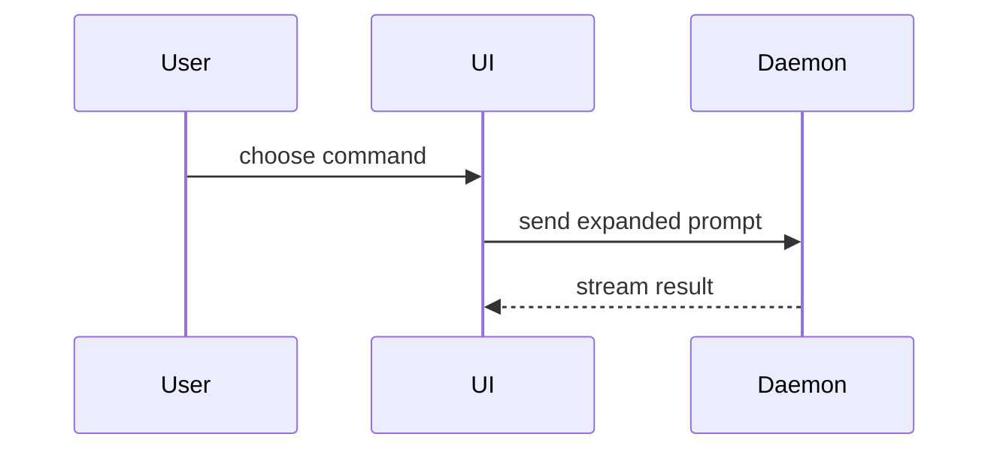

# Show me

Make the key relationship visible. Skip the preamble, keep prose brief, and
place each visual next to the sentence it supports. Prefer one clear view over a
gallery of loosely related diagrams.

Ground the visual in the current evidence: use real file paths, function and
component names, states, labels, and data when available. Mark a hypothetical
shape as hypothetical. Omit calls, files, props, and boundaries that do not help
answer the current question.

## Pick the smallest useful shape

- Use pseudocode for logic or an algorithm:

```text
on(save)
  if content is unchanged
    return cached result
  write new content
  return fresh result
```

- Use a call tree for runtime control flow:

```text
submitForm
  createSession
    persistPrompt
    launchAgent
  navigateToSession
```

- Use a component tree for UI ownership, including only the state and module
  boundaries that matter:

```tsx
<SessionPage> (apps/example/src/routes/session.tsx)
  useSessionEvents()
  <SessionToolbar>
    <RunSkillButton> (packages/ui)
```

- Use a shallow file tree for responsibility or a broad refactor:

```text
src/
├── commands/       # parses user actions
├── sessions/       # owns session state
└── transport/      # sends API requests
```

- Use Mermaid when interaction, sequence, data flow, or hierarchy is easier to
  understand as a diagram:



- Use a diff when the point is what changes and the surrounding shape already
  exists. Match the diff shape to the topic:

```diff
 submitForm
   createSession
     persistPrompt
+    expandSkillMention
     launchAgent
-  navigateToSession
+  navigateToSession
+    subscribeToEvents
```

Show the whole block when most of it is new, when omitted context would hide
ownership or order, or when the user needs a copyable target shape.

## Rich visual artifacts

Create one focused HTML diagram, infographic, or short slide sequence only when
the user explicitly asks for an artifact or interactive visual. Use the
environment's supported visualization or artifact workflow rather than assuming
a platform-specific shell command.

Match an existing product's colors, type, spacing, and components when that
context exists. Use real labels and data, support desktop and mobile, preserve
accessible reading order, and verify the rendered result before handing it off.
Follow the repository's provenance contract for any durable artifact. Return a
clickable path or open the result through the environment's supported handoff.

## Completion check

The explanation is complete when the chosen visual makes the key relationship
clear, its labels are evidence-grounded or explicitly hypothetical, and the
surrounding prose adds meaning instead of repeating the picture.

Adapted from HumanLayer's `show-me` skill at commit
`4d8d644ca747517973f58d7953f58d7cd07520cd`; see `LICENSE`.
